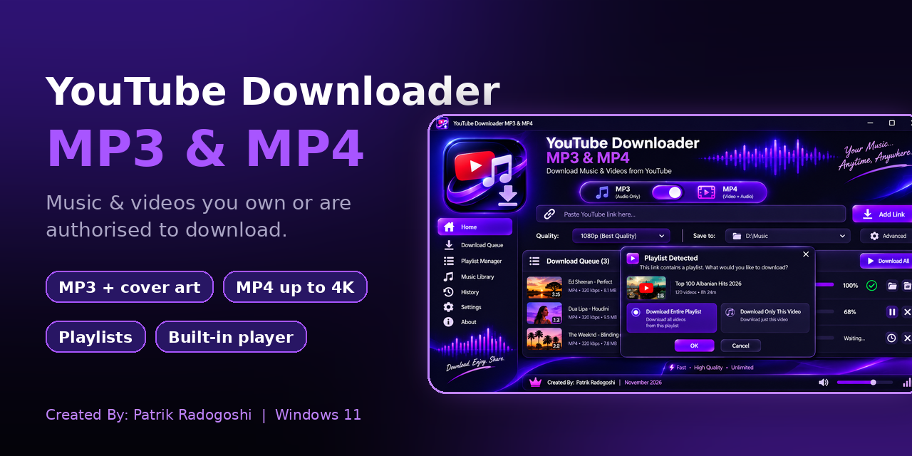

# YouTube Downloader MP3 & MP4
### AUDIOFLOW – Neon Purple Premium UI

Download music and videos you own or are authorised to download – with a modern Windows desktop app.

**[⬇ Download the latest version](https://github.com/PatrikRadogoshi/YouTube-Downloader-MP3-MP4/releases/latest)**  ·  Windows 11  ·  English · Shqip · Deutsch

---

## English

### Features
- **MP3** (128 / 192 / 256 / 320 kbps) with title, artist and cover art; **MP4** up to the highest resolution the video really has (up to 4K).
- **Playlists:** detects playlists, lets you download everything, only the current video, or pick individual tracks.
- **Clipboard detection:** copy a YouTube link and the app picks it up – even from the System Tray.
- **Built-in search:** type a song name instead of a link.
- **Download queue:** separate MP3 and MP4 lists, sorting, retry, clear, auto-clear, "download also as MP4/MP3".
- **Library and built-in player** (cover art / video, play, stop, volume).
- **7 themes** (purple, blue shades and an Albania theme), **3 languages**, separate folders for MP3 and MP4.
- **Automatic updates** for the app and the downloader engine.

### Install
1. Download [`YouTubeDownloader_Setup.exe`](https://github.com/PatrikRadogoshi/YouTube-Downloader-MP3-MP4/releases/latest/download/YouTubeDownloader_Setup.exe) (always the latest version; all versions are on the [Releases](https://github.com/PatrikRadogoshi/YouTube-Downloader-MP3-MP4/releases) page).
2. Run it and choose your language and install folder.
3. Copy a YouTube link – the rest is automatic.

**Windows SmartScreen / antivirus warning?** The installer is new and not yet code-signed, so Windows may show "Windows protected your PC". Click **More info → Run anyway**. You can verify the file: compare `Get-FileHash .\YouTubeDownloader_Setup.exe` with the published `.sha256` file.

### Legal
Use this software only for content that you own or are authorised to download. It does not bypass DRM or access controls. You are responsible for following YouTube's Terms of Service and copyright law. The software is provided "as is", without warranty.

### Credits
Created By: Patrik Radogoshi – Kosovo / Gjakova – November 2026  ·  Powered By: Patrik Radogoshi
Built with [yt-dlp](https://github.com/yt-dlp/yt-dlp) (Unlicense), [FFmpeg](https://ffmpeg.org) (GPL/LGPL) and PySide6/Qt (LGPL).

---

## Shqip

### Çfarë ofron
- **MP3** (128 / 192 / 256 / 320 kbps) me titull, artist dhe kopertinë; **MP4** deri në rezolucionin më të lartë që e ka videoja (deri në 4K).
- **Lista (playlist):** i zbulon vetë; shkarkon të gjithën, vetëm videon aktuale, ose zgjedh këngë një nga një.
- **Zbulim nga clipboard:** kopjo një link YouTube dhe aplikacioni e merr vetë – edhe kur është në System Tray.
- **Kërkim i integruar:** shkruaj emrin e këngës në vend të linkut.
- **Radha e shkarkimeve:** listë e veçantë për MP3 dhe MP4, renditje, riprovim, pastrim, auto-pastrim dhe "shkarko edhe si MP4/MP3".
- **Bibliotekë dhe luajtës i brendshëm** (kopertinë / video, play, stop, volum).
- **7 tema** (vjollcë, blu dhe tema Albania), **3 gjuhë**, dosje të ndara për MP3 dhe MP4.
- **Përditësime automatike** për aplikacionin dhe motorin e shkarkimit.

### Instalimi
1. Shkarko [`YouTubeDownloader_Setup.exe`](https://github.com/PatrikRadogoshi/YouTube-Downloader-MP3-MP4/releases/latest/download/YouTubeDownloader_Setup.exe) (gjithmonë versioni i fundit; të gjitha versionet janë te [Releases](https://github.com/PatrikRadogoshi/YouTube-Downloader-MP3-MP4/releases)).
2. Ekzekutoje, zgjidh gjuhën dhe dosjen e instalimit.
3. Kopjo një link YouTube – pjesa tjetër është automatike.

**Paralajmërim nga Windows SmartScreen ose antivirusi?** Installer-i është i ri dhe ende i panënshkruar, ndaj Windows mund të shfaqë "Windows protected your PC". Shtyp **More info → Run anyway**. Mund ta verifikosh skedarin: krahaso `Get-FileHash .\YouTubeDownloader_Setup.exe` me skedarin `.sha256` të publikuar.

### Ligjore
Përdore këtë program vetëm për përmbajtje që e ke ti ose që ke leje ta shkarkosh. Nuk anashkalon DRM-në apo kontrollet e qasjes. Je përgjegjës të respektosh kushtet e YouTube-it dhe të drejtat e autorit. Programi ofrohet "siç është", pa garanci.

### Krijuesi
Krijuar nga: Patrik Radogoshi – Kosovë / Gjakovë – Nëntor 2026  ·  Mundësuar nga: Patrik Radogoshi
